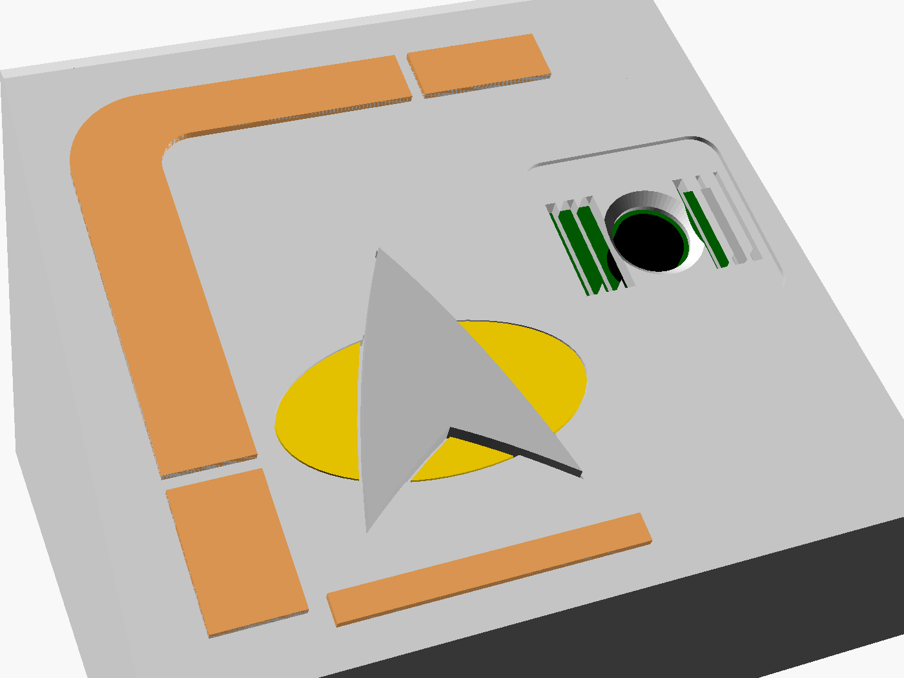

# Starfleet voice console (XIAO ESP32S3 Sense)

A desk enclosure for a Seeed XIAO ESP32S3 Sense used as a Home Assistant voice satellite.
It has a sloped LCARS-style face, a two-part combadge inlay, a camera window with a mic grille,
a USB-C opening on the right side and a bay for a LiPo battery.



Outside size: 84 × 64 mm footprint, 48 mm tall at the back.

## Parts (`stl/`)

| File | Print | Notes |
|---|---|---|
| `body.stl` | Open back on the bed, as exported | No supports needed. 0.2 mm layers, 3 walls. |
| `back.stl` | Outer face down | Has vents, a power-switch slot and a debossed "NCC-1701-D". |
| `sled.stl` | As exported (pins up) | Board holder. Glue it inside the face with its two pins in the holes. |
| `badge_oval.stl` | Flat | Gold or yellow filament. |
| `badge_delta.stl` | Flat | Silver or grey filament. Glue it on top of the oval. |

The raised LCARS panels are part of the body. Paint them with acrylic paint pens
(orange, peach and lilac look right) or leave them plain.

## Hardware

- Seeed XIAO ESP32S3 **Sense** (with its camera and mic expansion board fitted)
- 4 × M3 × 8 mm self-tapping screws (or M3 screws with heat-set inserts after widening the pilots)
- 4 × 8 mm stick-on rubber bumpers (optional)
- For battery power: a 3.7 V 1S LiPo pouch cell, 603450 size (about 6 × 34 × 50 mm, 1000 mAh),
  plus an SS12D00 mini slide switch

## Battery

The XIAO ESP32S3 already has a LiPo charger built in. Solder the battery to the **BAT+ / BAT−**
pads on the underside of the XIAO, with the slide switch in the + lead. USB-C then powers the board
and charges the battery at the same time.

- Sense power draw is about 55 mA recording audio and 150–210 mA streaming the camera
  (Seeed's own figures). Expect several hours of voice use from 1000 mAh, and less with the camera on.
- Charging is only 100 mA, so a flat 1000 mAh cell needs about 10 hours. A 500 mAh cell (503035)
  charges faster and fits the same bay.
- Charging only works while the switch is on.
- The XIAO can't measure battery voltage on its own. To show battery level in Home Assistant,
  add a 2 × 200 kΩ divider from BAT+ to an analog pin (A0) and read it with an ESPHome `adc` sensor.
- Buy a cell with a built-in protection circuit (most JST-lead pouch cells have one). Don't let the
  leads short while you're soldering.

## Assembly

1. Glue the sled inside the face (CA glue). The camera hole should sit over the middle of the sled opening.
2. Push the board into the sled, camera side first, with the USB-C end toward the right-side opening.
   A dot of hot glue keeps it in place.
3. Stick the battery to the floor between the rails with foam tape. Glue the switch into its slot in the back plate.
4. Glue the oval into the face pocket and the delta on top of it.
5. Screw the back plate on.

## Adjusting the fit

Everything is set by parameters at the top of `xiao_console.scad` (OpenSCAD 2021+).
The values most likely to need checking against your board:

- `cam_du`, `cam_dv`: move the camera hole if the lens isn't centred on the board.
- `usb_depth`: where the USB-C port sits behind the face.
- `usb_open`: opening size. The default of 13 × 7.5 mm fits most slim cables, but chunky plugs won't fit.
- `bat`: battery bay size.

To export a part:

```
openscad -D 'part="body"' -o stl/body.stl xiao_console.scad
```
