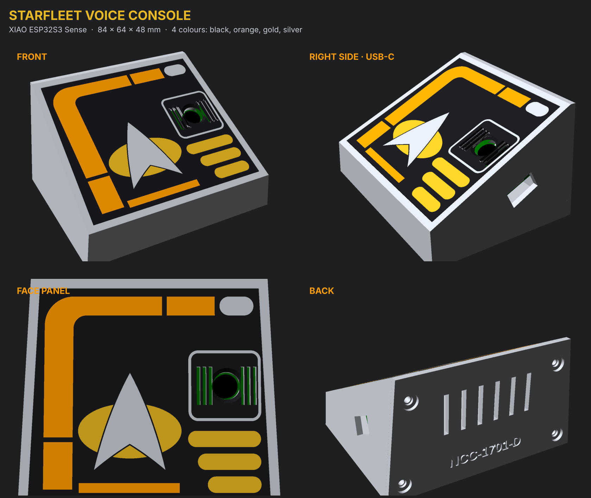

# Starfleet voice console (XIAO ESP32S3 Sense)

A desk enclosure for a Seeed XIAO ESP32S3 Sense used as a Home Assistant voice satellite.
It has a sloped case, a flat LCARS face panel with a combadge, a camera window with a mic grille,
and a USB-C power opening on the right side.

It prints in **four colours: black, orange, gold and silver.** Only the face panel is multi-colour,
and its colours are all in the first three layers, so the printer swaps filament for just those
layers. The case, back plate and sled print in silver.



Outside size: 84 × 64 mm footprint, 48 mm tall at the back.

## Parts (`stl/`)

| File | Colour | Print |
|---|---|---|
| `body.stl` | Silver | Open back on the bed, as exported. No supports. 0.2 mm layers, 3 walls. |
| `back.stl` | Silver | Outer face down. Vents and a debossed "NCC-1701-D". |
| `sled.stl` | Silver (any) | As exported, pins up. |
| `panel_black.stl` | Black | Face panel, part 1 of 4. |
| `panel_orange.stl` | Orange | Face panel, part 2 of 4. |
| `panel_gold.stl` | Gold | Face panel, part 3 of 4. |
| `panel_silver.stl` | Silver | Face panel, part 4 of 4. Load all four together as one object (below). |

### Printing the face panel

1. In Bambu Studio, OrcaSlicer or PrusaSlicer, select all four `panel_*.stl` files and drag them in
   together. When asked "load these files as a single object with multiple parts?", choose **Yes**.
2. Assign a filament to each part: black, orange, gold, silver.
3. Use 0.2 mm layers. The colours are 0.6 mm deep (3 layers) and the panel is 1.2 mm thick.
   The panel prints face-down, so the visible side comes out with the bed's texture or shine.
4. A smooth PEI or glass plate gives the cleanest finish.

## Hardware

- Seeed XIAO ESP32S3 **Sense** (with its camera and mic expansion board fitted)
- 4 × M3 × 8 mm self-tapping screws (or M3 screws with heat-set inserts after widening the pilots)
- 4 × 8 mm stick-on rubber bumpers (optional)
- A USB-C cable and 5 V USB power supply

## Assembly

1. Glue the face panel into the pocket on the front (a few dots of CA glue). Line up its camera hole and mic slots with the case.
2. Glue the sled inside the face (CA glue), pins in their holes.
3. Push the board into the sled, camera side first, with the USB-C end toward the right-side opening.
   A dot of hot glue keeps it in place.
4. Screw the back plate on.

## Adjusting the fit

Everything is set by parameters at the top of `xiao_console.scad` (OpenSCAD 2021+).
The values most likely to need checking against your board:

- `cam_du`, `cam_dv`: move the camera hole if the lens isn't centred on the board.
- `usb_depth`: where the USB-C port sits behind the face.
- `usb_open`: opening size. The default of 13 × 7.5 mm fits most slim cables, but chunky plugs won't fit.

To export a part:

```
openscad -D 'part="body"' -o stl/body.stl xiao_console.scad
```
